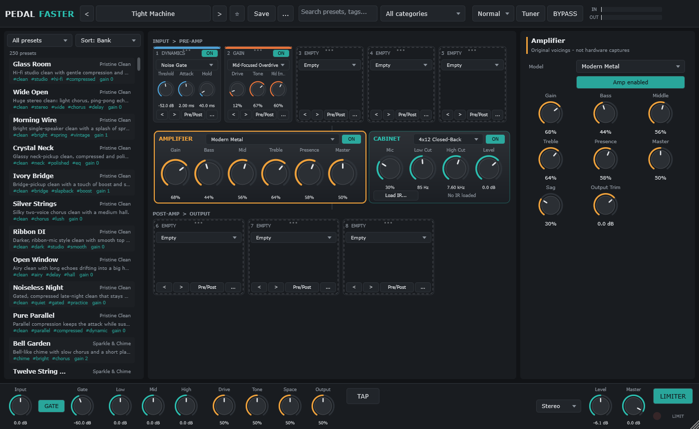

# Pedal Faster

A native C++ guitar amp and multi-effects rig for Windows: **VST3 plugin + standalone app**, built with JUCE 9.0.5 and C++20.

- **30 pedal algorithms**, each its own DSP class: dynamics, gain, filters, EQ, modulation, pitch, delay, reverb and a bitcrusher
- **6 original amp models**: Studio Clean, Class A Chime, British Crunch, Hot Rod Lead, Modern Metal and Bass DI / Amp, with 1x / 2x / 4x oversampling
- **Cabinets**: 1x12 and 2x12 open-back, 4x12 closed-back, 4x10 and 1x15 bass, Direct, plus a **custom WAV/AIFF impulse-response loader**
- **8 configurable pedal slots** that you can drag, reorder, bypass and move pre/post amp, with copy, paste, save and load per pedal
- **250 factory presets in 25 banks**: the 20 specified banks (200 presets) plus Electronic Ambient, Hardstyle, Drum & Bass, Dubstep and Synthwave
- Searchable preset browser with categories, tags, favourites, user presets and single-preset/bank import and export
- Tuner, tap tempo, host tempo sync, 4 macros (Drive / Tone / Space / Output), MIDI CC control, master EQ, output limiter and a CPU meter



## Quick start

```bat
build.bat          :: fetches JUCE 9.0.5, builds VST3 + Standalone + tests (Release)
install.bat        :: copies the VST3 to C:\Program Files\Common Files\VST3 (asks for admin)
```

Build outputs go to `%LOCALAPPDATA%\PedalFaster\build`, so OneDrive doesn't sync about 1 GB of intermediate files:

| Output | Path |
|---|---|
| VST3 bundle | `%LOCALAPPDATA%\PedalFaster\build\PedalFaster_artefacts\Release\VST3\Pedal Faster.vst3` |
| Standalone | `%LOCALAPPDATA%\PedalFaster\build\PedalFaster_artefacts\Release\Standalone\Pedal Faster.exe` |
| Test runner | `%LOCALAPPDATA%\PedalFaster\build\PedalFasterTests_artefacts\Release\PedalFasterTests.exe` |

`install.bat` also installs the standalone app to `C:\Program Files\Pedal Faster` and adds a Start Menu shortcut. `uninstall.bat` removes them and keeps your presets.

## Scripts

| Script | Purpose |
|---|---|
| `build.bat` / `scripts/build-windows.ps1` | Configure and build the Release VST3, Standalone and tests |
| `scripts/test-windows.ps1` | Run the 6,800+ automated checks (`-Category DSP\|Presets\|Integration`, `-UpdateBaseline`) |
| `scripts/validate-windows.ps1` | pluginval (strictness 10) + Steinberg VST3 validator (`-BuildSteinbergValidator`) |
| `scripts/package-windows.ps1` | Build `dist\PedalFaster-1.0.0-win64.zip` (VST3, exe, installer scripts, preset JSON, manual) |
| `install.bat` / `uninstall.bat` | Install or remove the VST3 and standalone app |

## Status

See [docs/VALIDATION.md](docs/VALIDATION.md) for the exact test and validation results, and for what has **not** been verified, such as testing in specific DAWs with a live guitar.

## Documentation

- [User manual](docs/USER_MANUAL.md): signal chain, controls, presets, MIDI, keyboard shortcuts
- [Building](docs/BUILDING.md): toolchain, commands, packaging, troubleshooting
- [Architecture](docs/ARCHITECTURE.md): threading model, real-time safety, state, automation mapping
- [DSP design](docs/DSP_DESIGN.md): how each amp, cabinet and pedal algorithm works
- [Preset format](docs/PRESET_FORMAT.md): JSON schema, parameter tables, migration
- [Licenses](LICENSES.md)

## Layout

```
src/
  PluginProcessor.*      host glue: parameters -> engine, presets, state, MIDI, IR loading
  PluginEditor.*         window: top bar, browser, chain, parameter panel, bottom bar, tuner
  Parameters.*           stable host-parameter IDs and layout
  dsp/                   JUCE-light DSP: DspCommon, EffectRegistry, SignalChain, AudioEngine, Tuner
    effects/             Dynamics, Gain, Filters, Modulation, Pitch, Delay, Reverb
    Amps/                AmpModels (6 voicings), AmpSection (oversampling, switching, bypass)
    Cabinets/            Cabinet (filter voicings + convolution IR loader)
  presets/               Preset model, JSON serializer/validator, factory library, manager
  ui/                    Theme, widgets, preset browser, signal-chain view, parameter editor
resources/presets/factory/   the factory library exported as JSON (reference copy)
tests/                   DSP, preset and integration tests + calibration/export tools
scripts/                 PowerShell build / test / validate / package
```
